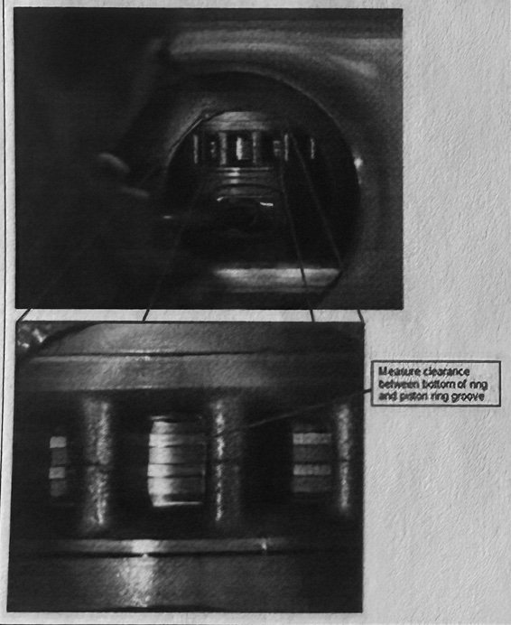
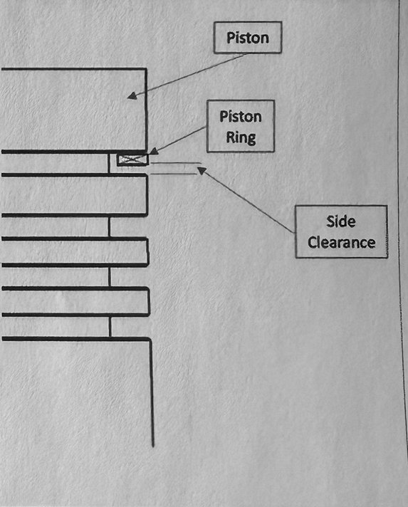

# Main Engine Airbox Inspection — EMD (2 × 16 cyl)

## Step 1 — Preparation & Safety

### Parts required
- Ring clearance reading log (record per cylinder)

### Tools / consumables required
- Rags, oil pads
- Feeler gauges (start at .006")
- Flashlight
- Barring mechanism

### Safety notes / cautions / warnings
**PPE:** Safety shoes, eye protection, ear protection, lockout/tagout.

**WARNING:** The main engine poses many hazards and potential energy release. All sources of energy (electrical, fuel, compressed air, lube oil, etc.) shall be isolated before undertaking work.

**CAUTION:** Vessel will be in a reduced capability / performance state during this task. Complete only while not transiting.

**IMPORTANT:** Allow at least 7.5 min per location. Estimated time: 16 cyl — 120 min/engine. Ring clearance readings must be recorded in the notes section for each cylinder.

## Step 2 — Airbox Inspection and Ring Clearance Procedure

### 1. Notify Wheelman
Notify the wheelman on watch you will be performing this procedure.

### 2. Permit to Work
Complete a Permit-to-Work with all persons involved and discuss the need for additional measures such as Perimeter Security, Fall-Arrest Protection, and Equipment Lockout / Tagout.

### 3. Notify Reduced Capability State
Notify the wheelman that the vessel will be in a reduced capability / reduced performance state.

### 4. Secure Engine and LOTO
Secure the main engine to be inspected. Secure fuel supply and start air (if applicable). Apply lockout and tagout on the fuel supply, air supply (if applicable), and any other sources of energy. Allow the engine to cool if time permits. Otherwise, protect from hot surfaces.

### 5. Gain Access to Airbox
Gain access to the engine's airbox.

a. Open the hand hole covers for every cylinder

b. Observe the piston positions on one bank prior to barring or starting the inspection — this observation determines which piston to inspect first

### 6. Inspect Both Airbox Banks
Airbox shall be relatively clean, free of excessive oil and soot, and free of water / coolant:

- Oil and carbon buildup may be evident — normal to a degree for two-stroke engines
- If buildup is excessive, inspect for source and consult Port Engineer

Airbox shall be free of foreign material and debris:

- If foreign material is found, determine source and consult Port Engineer

Wipe down the airboxes to remove excessive oil and/or carbon buildup.

### 7. Bar Engine for Ring Measurement
Slowly bar the engine until a top ring becomes visible for measurement.

For greatest accuracy, top ring side clearance should be measured while the piston is on the way down. Top rings that are visible shall not be measured until the piston is moving downwards.

### 8. Position Feeler Gauge Away from Ring Gap
Once the piston is in a suitable position for inspection, ensure the ring gap is not near the measurement location. Take measurements at least two ports away from the ring gap.

### 9. Measure Ring Side Clearance
Starting with a thin feeler gauge (.006") measure ring side clearance:

a. Insert the feeler gauge between the bottom surface of the ring and the groove clearance of the top ring. Increase feeler gauge thickness incrementally until it cannot be readily inserted

b. Feeler gauge should insert 3/16" or greater to be considered valid

c. The reading is the thickness of the gauge that could be readily inserted last

### 10. Broken Ring and Power Assembly Criteria
Broken rings may be easily discernible or indicated by a dark or blackened ring face. Broken rings warrant a power assembly change.

Power assemblies shall also be replaced if:

- 710 engines only — ring clearance is measured at .018" and the assembly has less than 20,000 operating hours
- 645 & 710 engines — any questionable findings (high ring clearance with low hours, excessively high ring clearance at higher hours). Consult Port Engineer before any power assembly change.

 

### 11. Record and Repeat
Record clearance and move onto the next location. Measure the remaining location's ring clearances in the same manner. As the engine is barred over, inspect each liner and piston. Consult Port Engineer if any issues are found.

### 12. Clean and Close Airbox
Ensure airbox is clean — remove any parts / tools left in the airbox, remove any rags or other items used to clean / protect from heat. Reinstall hand hole covers.

### 13. Remove LOTO and Start
Remove lockout / tagout and re-energize the isolated energy sources. Start engine (according to normal starting procedures) at idle and allow to warm.

a. Perform thorough walkarounds and inspections. Ensure hand holes are not leaking

b. Check for any unusual sounds

### 14. Bring to Operating Temps and Record
Bring engine to normal operating temperatures and pressures before giving the engine back to the wheelman. Record all ring clearance readings in the E-233-1-CM-M-2/16 PM task in V365.
