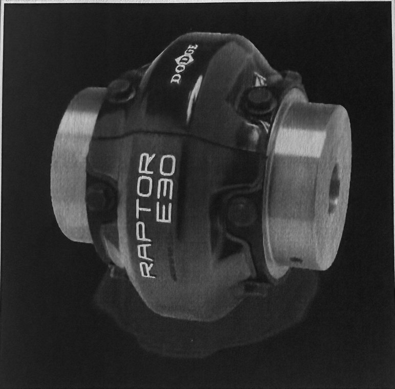
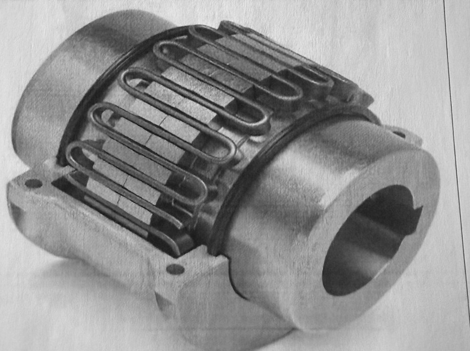
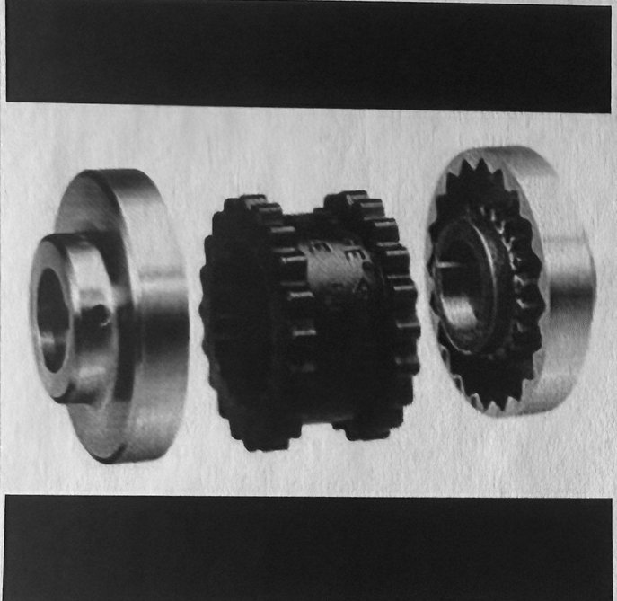
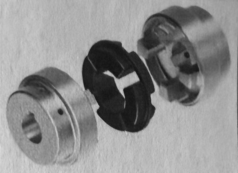
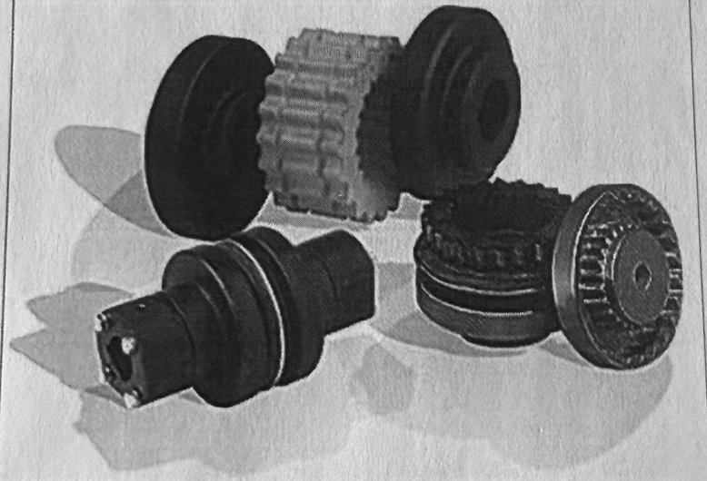
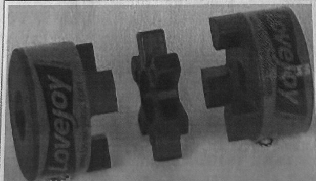

# Coupling Identification, Inspection and Replacement

## Step 1 — Preparation & Safety

### Parts required
- Replacement elements (type varies by coupling)
- Key stock (if required)

### Tools / consumables required
- Flashlight
- Emery cloth
- Straightedge ruler
- Feeler gauges
- Torque wrench / standard hand tools

### Safety notes / cautions / warnings
Purpose and Function — the coupling connects the driver (motor) to the driven equipment (pump) to transmit torque. It serves three functions: torque transmission, misalignment accommodation (parallel, angular, axial), and equipment protection (the insert is designed to fail before bearings or shafts in the event of shock load or seizure).

Schedule:
- Visual Inspection: WEEKLY
- Element Replacement: Dodge Raptor — replace on condition; All Other Types (Lovejoy, Magnaloy, Dodge Flex, etc.) — ANNUALLY

## Step 2 — Inspection / Installation Procedure

### 1. Remove Guard
Take fasteners loose and physically remove the guard from over the coupling to allow proper inspection access.

### 2. Debris Check
Inspect the guard interior and base. Black, orange, or red dust indicates the insert is grinding away due to misalignment.

### 3. Element Condition
- Look for hairline cracks, tears, or missing chunks in the rubber / urethane
- Check for bulging or distortion on tire-style elements
- Ensure no daylight is visible between the metal jaws and the spider legs (Lovejoy / Magnaloy)

### 4. Audible and Hardware Check
- Listen for clicking (metal-on-metal) or squealing (rubbing)
- Verify guard bolts are tight and coupling bolts (if visible) show no signs of backing out (e.g., fresh shiny threads exposed)

### 5. Verify Spare on Board
Visually verify (remove from box / packaging) that there is a spare element on board and that it passes the inspection criteria above.

### 6. Installation — Clean, Deburr, Gap, Key Fit, Torque
- Clean motor and pump shafts with emery cloth. Remove any burrs or high spots on the shaft or keyway to prevent the hub from seizing during install
- Do not push hubs flush against each other — consult the coupling manual for the required "N-Dimension" (gap between hubs) to allow thermal expansion and proper element fit
- Ensure key stock is not too tall (preventing hub slide-on) or too loose — it should fit snugly
- Tighten set screws or clamp bolts to the manufacturer's specified torque, or if unavailable, use standard ASME bolt thread torque

### 7. Alignment — Parallel (Offset) and Angular
Parallel (Offset):
1. Place a rigid straightedge ruler lengthwise across the OD of both coupling hubs
2. Check at 12, 3, 6, and 9 o'clock
3. Goal: the straightedge lays flat against both hubs simultaneously at all four points. Light between the ruler and one hub indicates offset

Angular:
1. Measure the gap between the faces of the two hubs at 12, 3, 6, and 9 o'clock
2. Goal: measurements should be nearly identical at all four points. Wider at the top than the bottom means the motor is tilted

If annual coupling changeout is required, print off the MPC-E-010-Coupling Replacement and Alignment Log sheet from the "Extra Documents" folder in the MPC folder of the Ripple Documents tab. Submit the log to your Port Engineer via email upon completion.

### 8. Coupling Identification Reference
Reference photos for coupling identification:

- Dodge Raptor
- Dodge Grid Type
- Dodge Flex Type
- Magnaloy Flex
- Lovejoy Flex
- Lovejoy Jaw Type

 

 

 
