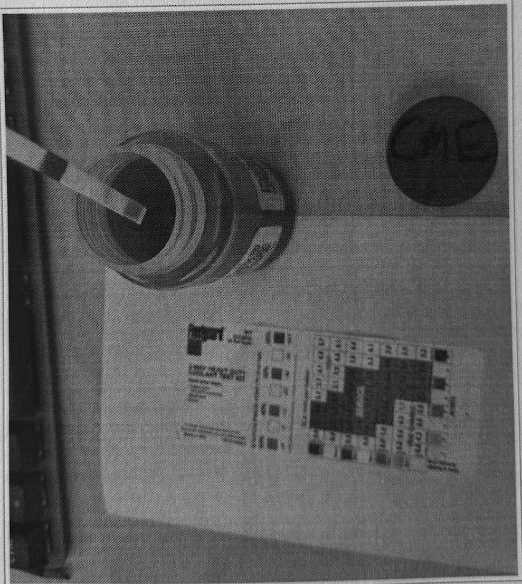
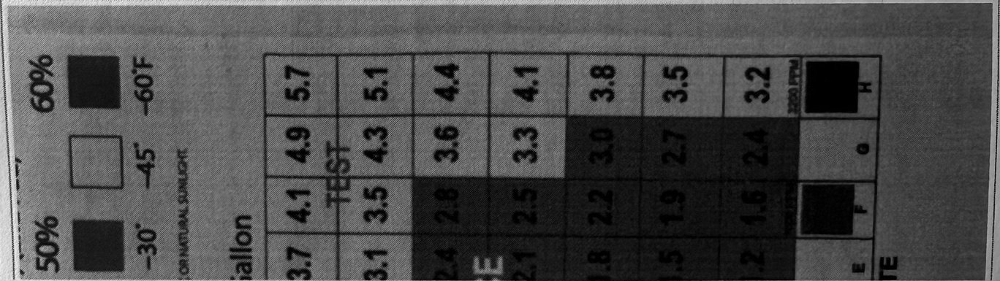

# Cooling Water Test

## Step 1 — Preparation & Safety

### Parts required
- Fleetguard 3-way Heavy Duty Coolant Test Strips (part # CC2602 or CC2602M metric)
- Approved coolant additive — Nalcool / Nalfleet 2000, CAT SCA, John Deere Cool-Gard, or Fleetguard ES (do NOT mix products)

### Tools / consumables required
- Rags
- Clean sample bottle (labeled for coolant only if re-used oil bottle)
- Various hand tools

### Safety notes / cautions / warnings
**PPE:** Safety toe boots, eye protection, ear protection, disposable nitrile gloves.

**WARNING:** The main engine poses many hazards and potential energy release. Isolate all sources of energy as necessary.

**CAUTION:** This task shall only be conducted while the vessel's engines are at idle or secured. Vessel will be in a reduced capability state — complete only when not transiting.

**IMPORTANT:** Do not take samples from a cold engine. Premix water treatment when adding concentrated additives. For main engines, introduce a maximum of 1-2 gallons to the expansion tank at a time.

SCA target band: 1.2 - 3.0 SCA units/gal (0.3 - 0.8 units/liter).

## Step 2 — Cooling Water Test Procedure

### 1. Gather Tools and Sample Bottle
Gather the necessary tools, sample kit, and sample bottle (preferred) needed to complete maintenance.

### 2. GAR SAFE
Complete a GAR SAFE with all persons involved and discuss the need for additional measures and Equipment Lockout / Tagout.

### 3. Identify Sampling Locations
Sampling locations:

- EMD 645 vessels — water pump bleed valve
- EMD 710 vessels — both water pump bleed valves
- Caterpillar vessels — water manifold drain
- Cummins vessels — system bleed valves
- Generators — cooling water inlet bleed valve
- Gear Boxes — any accessible cooling line, drain / bleed valve

DO NOT TAKE SAMPLES FROM THE EXPANSION TANK OR DAY TANK.

### 4. Collect Sample
a. Open the valve and allow coolant to flow for a few seconds; discard the initial flow appropriately

b. Fill the container with enough coolant to fully submerge the test strip's sampling pads

c. Secure the valve and verify it is leak free

### 5. Verify Sample Temperature
Sample should only be evaluated if between 50°F and 130°F. Allow to cool as necessary.

### 6. Apply Test Strip
Submerge the test strip in the coolant sample for one second. Remove and shake briskly for 45 seconds. Immediately compare test strip pads to the chart on the bottle.

### 7. Read Pads
- End pad = % Glycol / Freeze Point — Marquette does not use glycol-based coolants; do not record this value
- Middle pad = Molybdate (vertical chart)
- First pad = Nitrite (horizontal chart under the table)

If the middle pad does not change color, use Row 0. If the first pad does not change, use Column A.

