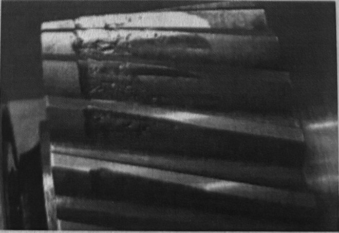
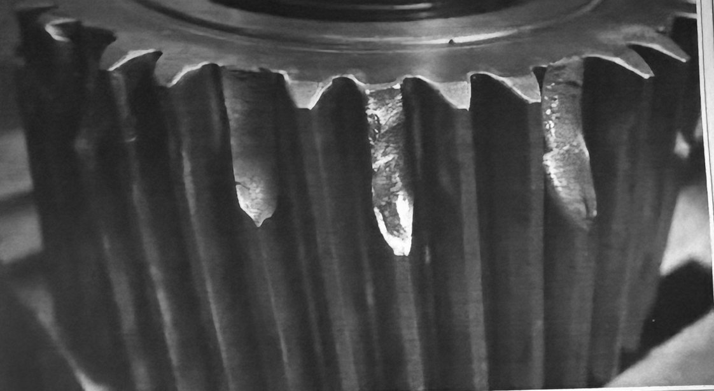
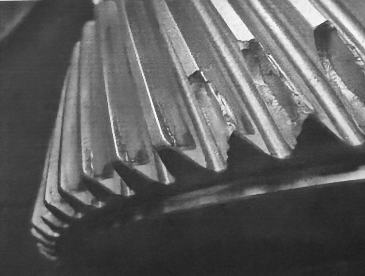

# Reduction Gear Maintenance

## Step 1 — Preparation & Safety

### Parts required
- Grease (zerk fittings, clutch cooling water pump bearings)

### Tools / consumables required
- Rags, oil pads, flashlight
- High-speed bearing grease gun
- Ball-peen hammer
- Soap and water (non-solvent cleaner)
- General hand tools

### Safety notes / cautions / warnings
**PPE:** Safety shoes, eye protection, ear protection.

**WARNING:** The reduction gear box has numerous sources of energy. Secure through appropriate LOTO guidance as needed.

**CAUTION:** Ensure engines are stationary and gear box(s) secured during and after this task.

**IMPORTANT:** Allow at least 2 hours per gear box. Repeat below procedure for each gear box.

## Step 2 — Reduction Gear Quarterly Maintenance

### 1. Gather Tools
Gather the necessary tools needed to complete maintenance.

### 2. Permit to Work
Complete a Permit-to-Work with all persons involved and discuss additional measures such as Perimeter Security, Fall-Arrest Protection, and Equipment Lockout / Tagout.

### 3. Inspect Mounting Bolts
Inspect all mounting bolts and shims for proper tightness.

a. Inspect that paint pen markings (if applied) have not shifted

b. Use of a ball-peen hammer may also be used. Strike each bolt — a loose bolt can be identified by an unusual sound or lack of hammer bounce-back

If mounting bolts are found in an unsatisfactory condition, immediately report findings to Port Engineer before proceeding.

### 4. Grease Cooling Water Pump (if applicable)
Grease cooling water pump bearings with 2-3 shots of high-speed bearing grease. Clean grease (zerk) fittings before attaching grease gun / nozzle.

### 5. Gain Access to Internals
Gain access to box internals by removing cover(s) or access hatch(s). Be careful not to contaminate internals with dust / debris or other foreign objects.

Document any suspicious findings through photograph. Contact Port Engineer before proceeding if findings are cause for concern.

### 6. Visual Inspection of Gears and Bearings
Visually inspect gear teeth and bearings for unusual wear, misalignment, inadequate backlash, or other damage:

a. Gear teeth may show excessive wear through pitting, spalling, crushing, or cracking

b. Excessive heat may be evident via metal discoloration — sign of various issues

c. Misalignment and backlash may be identified by macropitting (Figure 1)

d. Bearing wear may be identified by visual appearance, signs of overheating, leaks, etc.

e. Visually inspect surfaces for debris such as metal material, dirt, water, etc.

### 7. Check Internal Oil Piping
Check internal oil piping for damage and cracks of any kind.

### 8. Reinstall Cover / Hatch
Re-install cover(s) or access hatch(s), being mindful to not introduce foreign debris.
