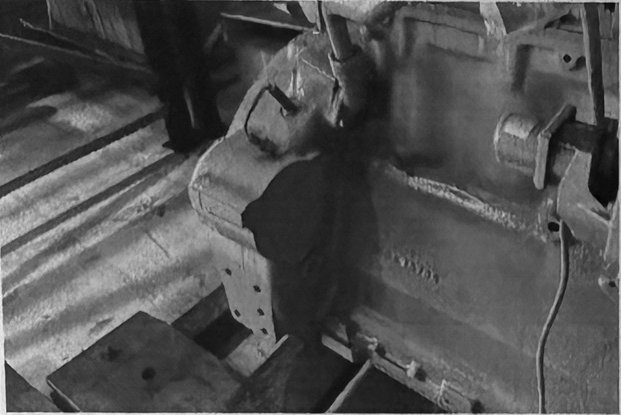
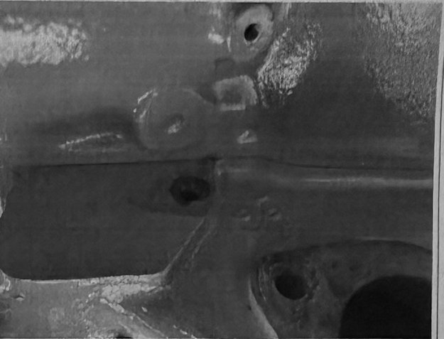
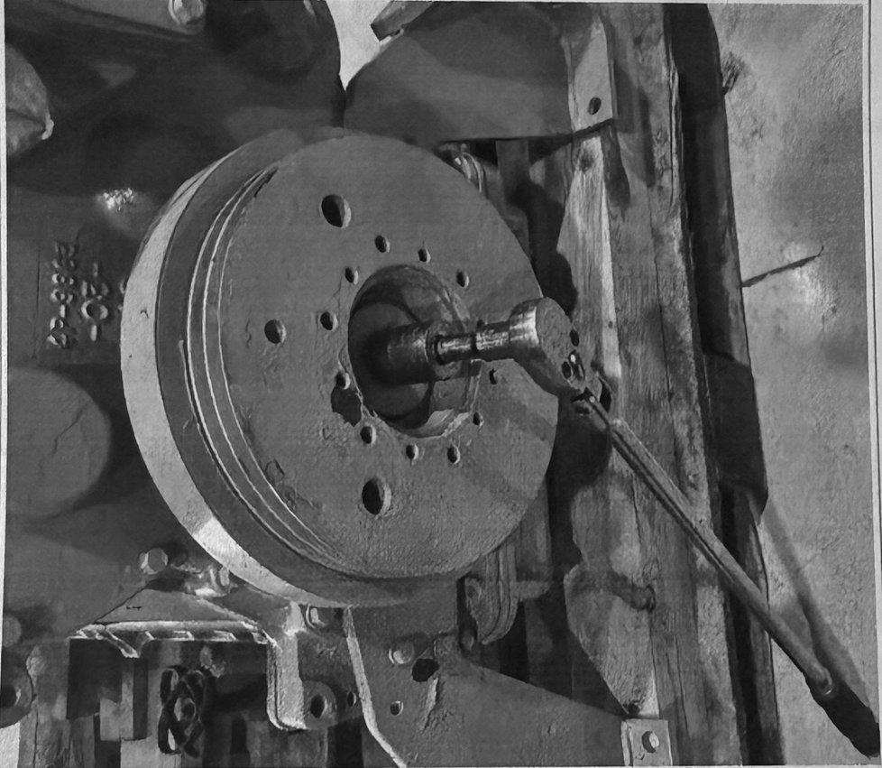
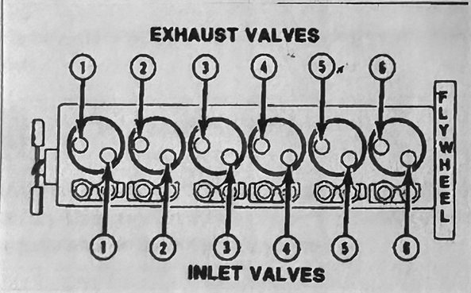
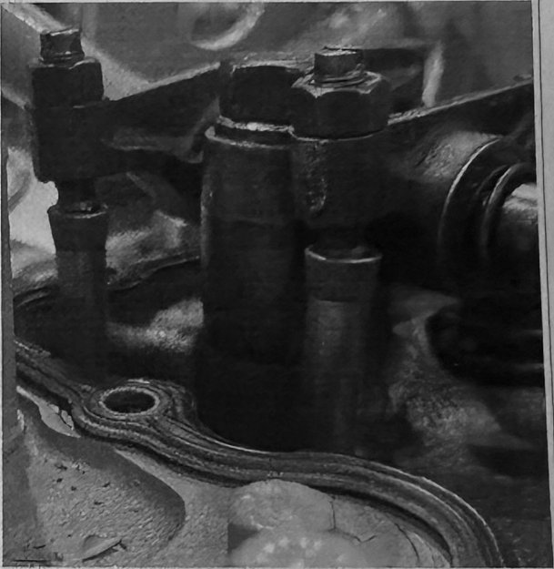
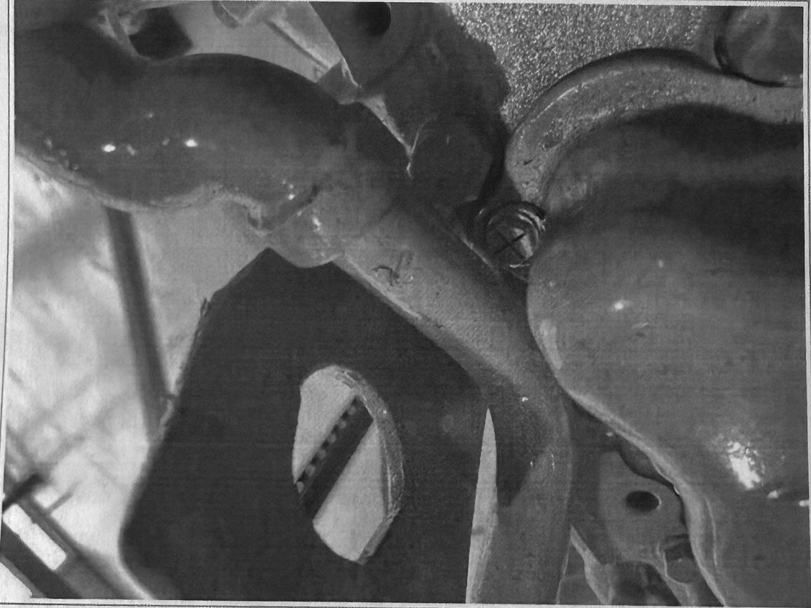

# Generator Engine Maintenance — CAT 3300 Series

## Step 1 — Preparation & Safety

### Parts required
- Valve cover gasket (if required)

### Tools / consumables required
- Rags, oil pads, flashlight
- 1/2" socket (swivel recommended)
- 9/16" wrench
- 1 1/8" socket and breaker bar
- Flat head screwdriver
- Torque wrench
- 3/8" bolt
- Feeler gauges (.015" intake / .025" exhaust)

### Safety notes / cautions / warnings
**PPE:** Safety toe boots, eye protection, ear protection, disposable nitrile gloves.

**WARNING:** Be sure the engine cannot be started while this maintenance is being performed. To prevent possible engine startup, do not use the starter to turn the flywheel.

**CAUTION:** Hot engine components can cause burns. Allow additional time for the engine to cool before measuring / adjusting valve lash.

Operation of a diesel engine with improper valve adjustment will reduce engine efficiency, which could result in excessive fuel usage and/or shortened engine life.

## Step 2 — Valve Lash Adjustment Procedure

### 1. Gather Tools
Gather the necessary tools and supplies needed to complete maintenance.

### 2. GAR SAFE / LOTOTO
Complete a GAR SAFE with all persons involved and discuss the need for additional measures and Equipment Lockout / Tagout / Tryout.

### 3. Remove Timing Pin Plug
Remove the timing pin plug from the flywheel housing (Figure 1).

 

### 4. Insert Timing Bolt / Pry Bar
Insert a 3/8" bolt or small rolling head pry bar into the timing pin hole (Figure 2).

### 5. Rotate Engine to Timing Position
Locate the 1 1/8" crankshaft pulley bolt. Utilize a breaker bar to rotate the engine in its normal operating direction while applying pressure to the bolt or pry bar (Figure 3). Rotate until the bolt or pry bar falls into the timing pin hole or indent on the flywheel. The timing hole indent is approximately 3/4" deep.

### 6. Clean and Remove Valve Cover
Clean the area around the valve cover to ensure no debris falls into the engine once removed.

Utilize the 1/2" swivel to remove valve cover bolts. The forward-most valve cover bolt may be difficult to remove and install. Once removed, it is recommended to cut a slot in the bolt head so that a flat head screwdriver can be used going forward.

Be careful not to introduce foreign debris when working.

### 7. Inspect Valve Train
Remove the valve cover. Inspect the valve train for damage and report / repair through an observation, as necessary. Inspect the valve cover gasket for damage or tears.

### 8. Determine TDC Compression Cylinder
With the timing pin in place, determine which cylinder (#1 or #6) is at TDC on the compression stroke:

- #1 Cylinder — If #1 is at TDC on compression, both intake and exhaust valves are closed. Verify by confirming both intake and exhaust push rods can be rotated by hand and both rocker arms can be moved
- #6 Cylinder — If #6 is at TDC on compression, both valves will be closed. Verify as above

### 9. Valve Lash Reference Table
Use the table below to determine which valves to set based on which cylinder is at TDC compression:

#1 on Compression Stroke → Intake: 1-2-4 | Exhaust: 1-3-5

#6 on Compression Stroke → Intake: 3-5-6 | Exhaust: 2-4-6

 

### 10. Set Intake Valves (.015")
Set intake valves using a 0.015" feeler gauge:

a. Insert feeler gauge between the rocker arm and intake valve

b. Feeler gauge should have slight drag when pulling between rocker and valve

Adjust intake valves as necessary:

a. Loosen the 9/16" locknut and tighten or loosen the adjusting screw until slight drag is obtained

b. Tighten locknut to 22 lb-ft

c. Repeat on the intake valves listed in the table for the current TDC cylinder

d. Re-check lash after torquing. Adjust as necessary to ensure .015"

### 11. Set Exhaust Valves (.025")
Set exhaust valves using a .025" feeler gauge:

a. Insert feeler gauge between the rocker arm and exhaust valve

b. Feeler gauge should have slight drag

Adjust exhaust valves as necessary:

a. Loosen the 9/16" locknut and tighten/loosen the adjusting screw until slight drag is obtained

b. Tighten locknut to 22 lb-ft

c. Repeat on the exhaust valves listed for the current TDC cylinder

d. Re-check lash after torquing. Adjust as necessary to ensure .025"

### 12. Rotate Engine One Revolution
Remove the timing pin and rotate the engine one revolution until the timing pin falls back into the timing pin hole.

### 13. Set Remaining Valves
If at the previous TDC check cylinder #1 was on the compression stroke, #6 is now in that condition (or vice versa). Use the table above to determine which valves can be set, and repeat intake and exhaust adjustments on the remaining valves.

### 14. Restore Engine
Replace the valve cover gasket if necessary and reinstall the valve cover. Torque valve cover bolts to 8 lb-ft.

Remove the timing pin and replace the plug. Remove all tools from the engine and ensure it is safe to run.

Remove LOTOTO and test run the engine. Note any unusual noise or vibrations and notify PE with any questions.

